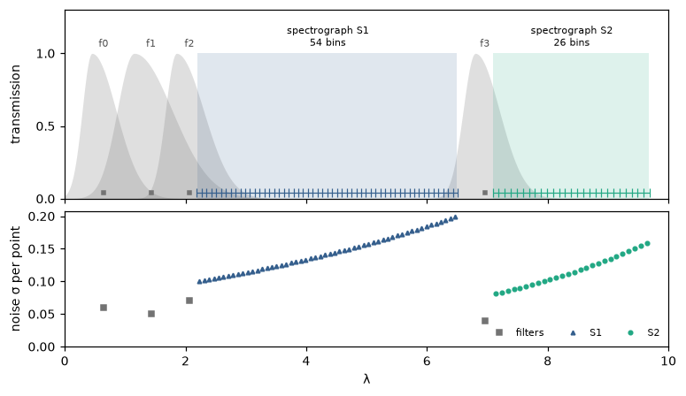
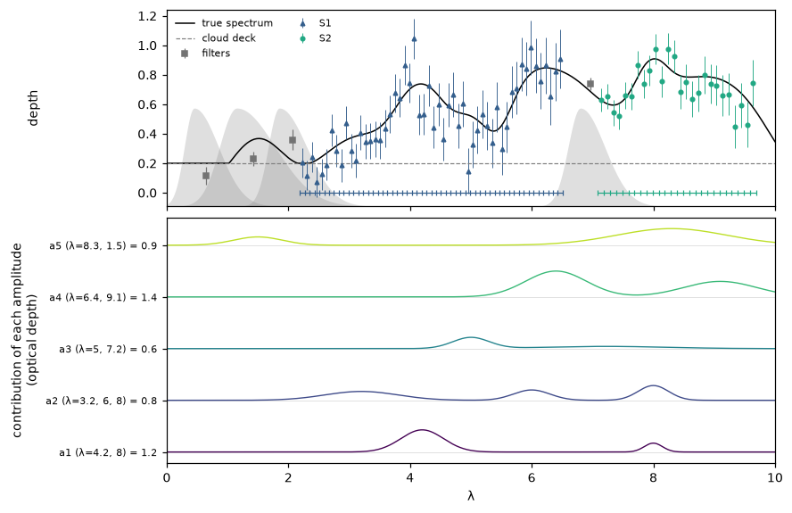
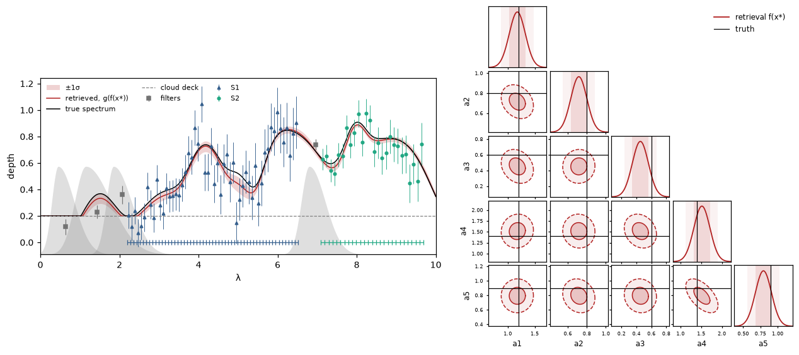
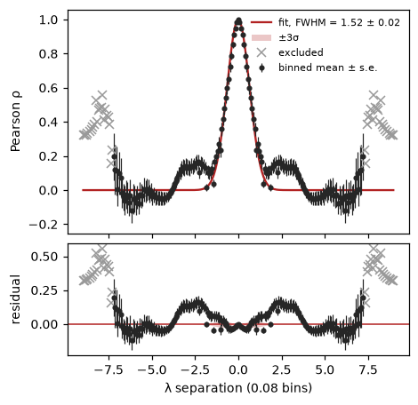
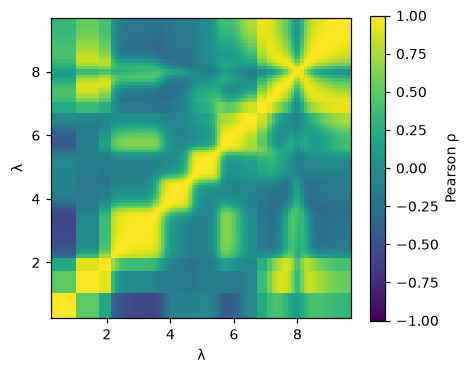
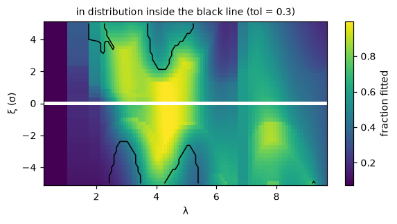
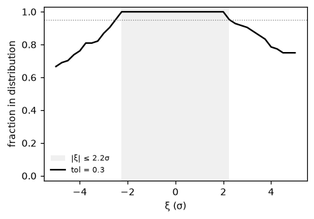
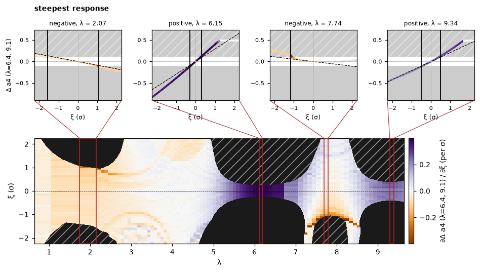
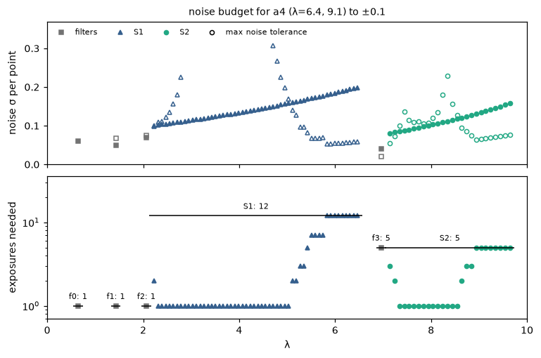
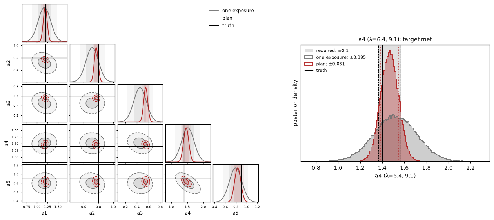

Perturb is usually used to ask *what does this answer depend on?* Here we read it backwards, as a requirement:

> We want to measure one parameter to ±0.1. How noisy can each data point be before it moves the answer by more than
> that, and how many exposures does each instrument need to get there?

The black box this time is not a neural network but a plain least-squares fit. Perturb doesn't mind: all it needs is
observations in and answers out.

The idea is simple. Nudge each region of the observation by a growing multiple of its noise, and note the first nudge
size that moves the answer by more than the target. That is how much noise the region can tolerate. Averaging N
exposures divides the noise by √N, which turns it into a number of exposures.

```python
import perturb as pt
from perturb import plotting
```

## The instrument

A toy spectrum is observed by 4 overlapping photometric filters and two spectrographs, S1 and S2. Top: what each one
covers. Bottom: the noise of every data point.

{: loading="lazy"}

## The spectrum and the target

The spectrum is set by 5 unknown amplitudes, each controlling bands in two or three places, which overlap so that
neighbouring amplitudes can partly trade off against each other. We want to pin down **a4**, which has one band at the
red end of S1 and one in S2. Bottom: the spectrum taken apart into each amplitude's contribution.

{: loading="lazy"}

## The black box

`f` fits the 5 amplitudes to an observation by least squares. One exposure of everything gets a4 to ±0.195, about
twice the target.

{: loading="lazy"}

## Step 1: the width of the kernel

As before, Perturb nudges a smooth neighbourhood rather than single points. Here the overall depth of the spectra
varies far more than their shape, so each prior spectrum is normalised first (`normalise=True`).

```python
fit = pt.fit_kernel_width(X_prior, obs["x_axis"], normalise=True)
FWHM = fit["fwhm"]
plotting.kernel_fit(fit)
plotting.correlation_matrix(fit)
```

```
kernel FWHM = 1.521 ± 0.016 in λ
```

{: loading="lazy"}

{: loading="lazy"}

## Step 2: how far to perturb

Two settings matter for a real instrument. The noise jumps between filters and spectrograph bins, so each point is
nudged by its **own** noise (`scale="own"`). And a least-squares fit takes one observation at a time
(`batch_size=1`).

```python
perturber = pt.Perturber(f, obs["x_axis"], obs["sigma"], FWHM, scale="own", batch_size=1)
wide = perturber(obs["y"], pt.magnitude_grid(xi_max=5, n=41))
curve = pt.in_distribution_curve(wide, forward, tol=0.3)
plotting.ood_map(curve, wide)
```

{: loading="lazy"}

```python
XI_MAX = pt.max_magnitude(curve)
plotting.in_distribution(curve)
```

```
in distribution up to |xi| = 2.25 sigma
```

{: loading="lazy"}

## Step 3: perturb the observation

To find where each response crosses the target we need a fine grid of nudge sizes, in steps of 0.1σ.

```python
result = perturber(obs["y"], pt.magnitude_grid(XI_MAX, 47))
```

## Step 4: the response against the target

With `threshold` set to the target, every response bigger than ±0.1 is blacked out. The blacked-out areas are the
regions where a single exposure isn't good enough.

```python
plotting.callouts(result, output=3, threshold=0.1, n_positive=2, n_negative=2, n_nonlinear=0)
```

{: loading="lazy"}

## Step 5: the noise budget

`result.crossing(target)` gives, for every position, the first nudge size (below and above zero) at which the answer
moves by the target. Taking the nearer one gives each point's largest allowed noise, and from that the number of
exposures it needs. A spectrograph reads all its bins in one exposure, so it needs as many as its most demanding bin.

```python
cross = result.crossing(0.1)[:, :, 3]                       # for a4
xi_c = np.fmin(np.abs(cross[:, 0]), np.abs(cross[:, 1]))    # the nearer side
allowed = xi_c * obs["sigma"]                               # largest noise each point can have
need = np.where(np.isnan(xi_c), 1, np.ceil(1 / xi_c**2))    # exposures each point needs
```

```
instrument points crossed tightest allowed noise exposures
        f0      1       0                    any         1
        f1      1       1                 0.0685         1
        f2      1       1                 0.0753         1
        S1     54      31                 0.0527        12
        f3      1       1                 0.0196         5
        S2     26      26                 0.0554         5
25 exposures in all
```

Top: each point's noise now (filled) and the most it can have (open). Bottom: the exposures each point needs, with
each instrument's line at the number it gets.

{: loading="lazy"}

## Checking the plan

Take that many exposures of each instrument and refit. The plan gets a4 to ±0.081, inside the ±0.1 target.

{: loading="lazy"}

It beats the target with room to spare because the budget is deliberately strict: it asks that no whole region,
moving together by its noise, shifts the answer too far. Independent noise in each bin partly cancels out, so treat
the budget as exact for noise that drifts smoothly with wavelength (a systematic, say) and as a safe upper bound for
white noise. It is also tied to this one truth and noise draw; for real planning, repeat it over plausible ones.

## Using it on your own retrieval

```python
import perturb as pt

fit = pt.fit_kernel_width(X_prior, x_axis)                                          # 1. kernel width
perturber = pt.Perturber(f, x_axis, sigma, fit["fwhm"], scale="own", batch_size=1)
xi_max = pt.max_magnitude(pt.in_distribution_curve(perturber(x, pt.magnitude_grid(5, 41)), forward))  # 2. how far
result = perturber(x, pt.magnitude_grid(xi_max, 61))                                # 3. perturb
cross = result.crossing(target)[:, :, p]                                            # 4. where it crosses
xi_c = np.fmin(np.abs(cross[:, 0]), np.abs(cross[:, 1]))
allowed = xi_c * sigma                                                              # 5. noise budget per point
exposures = np.where(np.isnan(xi_c), 1, np.ceil(1 / xi_c**2))                       #    ... and exposures
```
